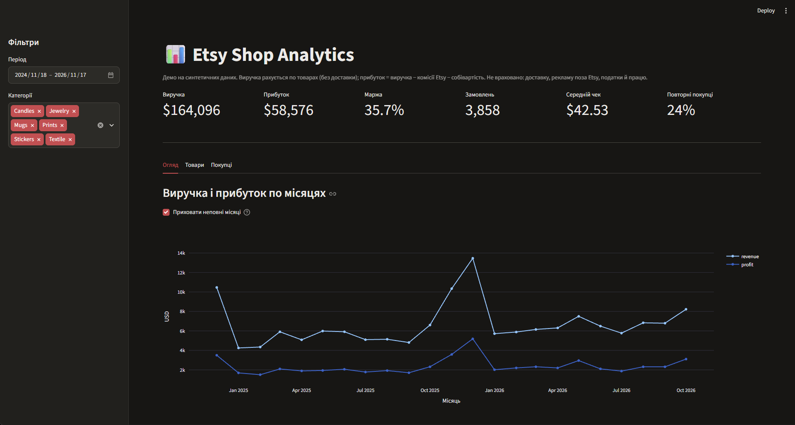
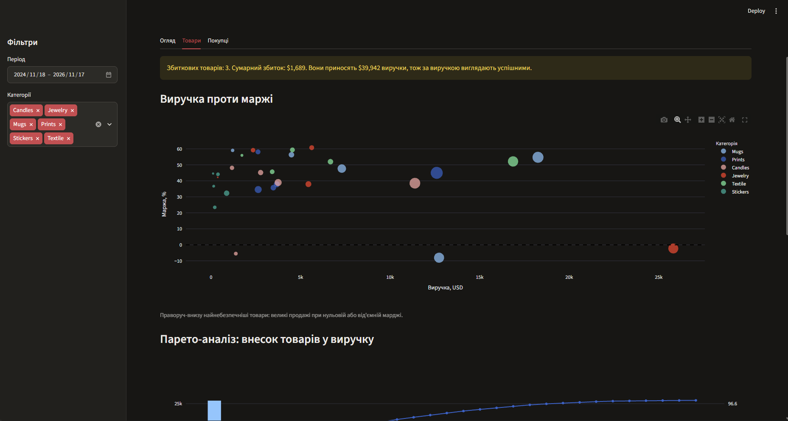
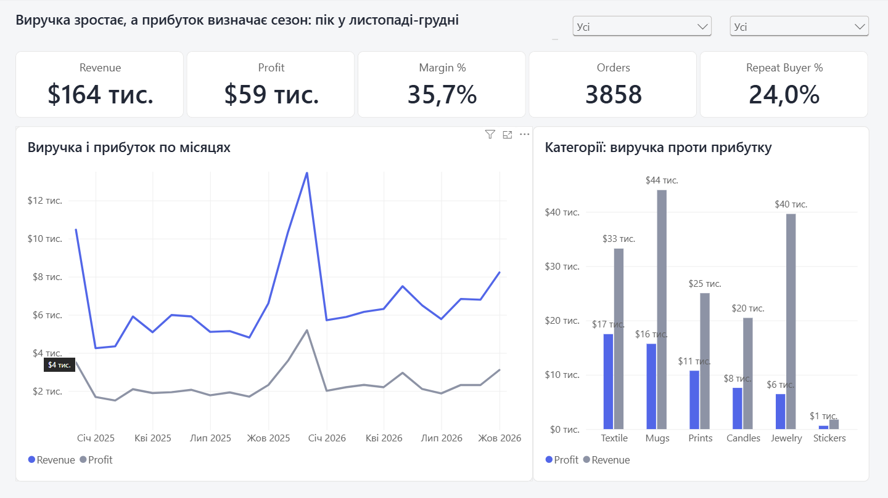
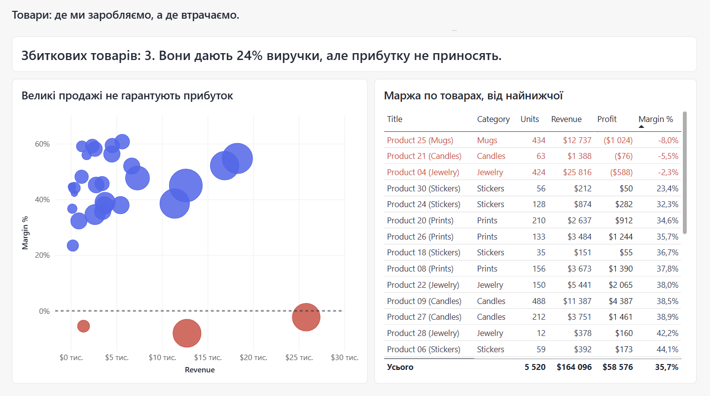
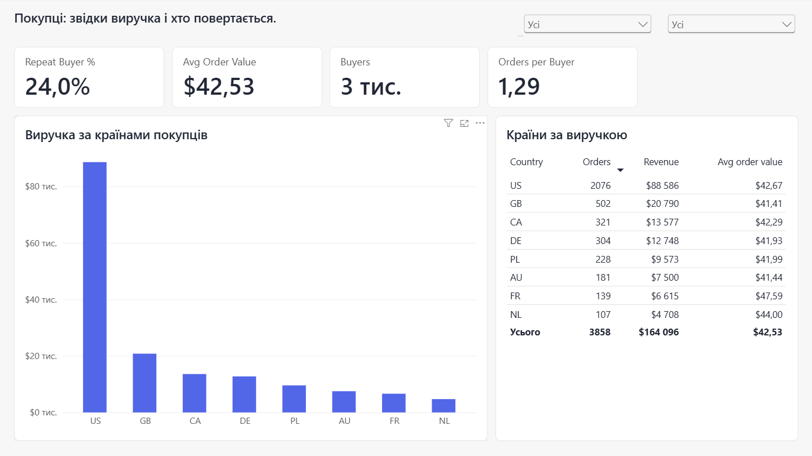

# Etsy Shop Analytics

[Українська версія](README.uk.md)

An end-to-end analytics project built around a small Etsy shop: data in PostgreSQL, SQL models, a Streamlit dashboard and a Power BI report on top of the same data.

> **Heads up:** every number in this repo comes from synthetic data. The real shop's data never goes to GitHub (more on that below).

## Why I built this

Some people I know run a handmade shop on Etsy. Etsy Stats tells them how much they sold, but not what they actually earned once fees and materials are subtracted. I wanted to answer one simple question: **which products are really worth making?**

I also wanted a project with a real business question instead of yet another outdated dataset.

## What's inside

- **Data generator** that creates a realistic fake shop: 30 products, 6 categories, about 3,900 orders over two years, with seasonality, growth and a few products that quietly lose money.
- **PostgreSQL** (Docker) with a small schema: listings, orders, order items, product costs, Etsy fees.
- **SQL views** that calculate profit per order item. Both dashboards read from the same view, so the numbers always match.
- **Streamlit dashboard** with filters, Pareto analysis and a revenue vs. margin chart.
- **Power BI report** (3 pages) telling the same story a bit differently.
- **Data quality tests** (pytest) and a GitHub Actions workflow that runs them on every push.

## Architecture

```
synthetic generator / Etsy API (planned)
        |
   CSV files (data/sample)
        |
   PostgreSQL: core.*  (tables)
        |
   PostgreSQL: analytics.v_item_facts  (one row per order item, with fees, costs and profit)
        |
   Streamlit dashboard        Power BI report
```

## What the data says

I planted these patterns in the generator myself, to check that the analysis finds them. They show the kind of answers the project is built to give on real data:

- **Three products lose money**, yet they bring in about 24% of all revenue. If you only look at sales, they look like successes.
- The biggest of them, a jewelry item, is the **#1 product by revenue (~$26k) with a negative profit**.
- **Jewelry** is the 2nd category by revenue but only 5th by profit. Textile earns more with less revenue.
- **Sales peak in November and December** (the typical Etsy holiday-gift seasonality), and the shop grows year over year.
- **US buyers bring more than half of the revenue**, and about **24% of buyers come back** for a second order.

## Dashboards

### Streamlit

| Overview | Products |
|---|---|
|  |  |

More screenshots: [overview, part 2](docs/streamlit_overview_2.png), [products, part 2](docs/streamlit_products_2.png), [customers](docs/streamlit_customers.png).

### Power BI

The report file is in `dashboard/powerbi/etsy_demo.pbix` (synthetic data only).

| Overview | Products | Customers |
|---|---|---|
|  |  |  |

## How profit is calculated

```
profit = revenue - Etsy fees - cost of goods
```

- Etsy charges fees per order (listing, transaction, payment processing, offsite ads). I split each order's fees between its items in proportion to their revenue.
- Cost of goods comes from a separate table, because Etsy doesn't know what the materials cost. In a real shop, the owner fills it in.
- **Not included:** shipping, ads outside Etsy, taxes and labour. So the margin isn't perfect, but it's close to reality.
- Fee rates in the generator are approximate. Check Etsy's current fees before trusting the absolute numbers.

## Data quality

`tests/test_data_quality.py` runs 10 checks: unique keys, no empty values in key columns, valid foreign keys, positive amounts, order total = items + shipping, known fee types, a realistic repeat-buyer rate and so on. The generator also plants three loss-making products on purpose, and a test makes sure they stay there.

```bash
pytest -q
```

## Run it yourself

You need Python 3.12+ and Docker.

```bash
git clone https://github.com/SerhiiKuzub/etsy-analytics.git
cd etsy-analytics

cp .env.example .env        # then set a password in .env
python -m venv .venv
source .venv/bin/activate
pip install -r requirements.txt

docker compose up -d
python -m src.synthetic.generate
python -m src.load.load_to_postgres

set -a; source .env; set +a
for f in sql/models/*.sql; do
  docker exec -i etsy_db psql -U "$POSTGRES_USER" -d "$POSTGRES_DB" < "$f"
done

streamlit run dashboard/app.py
```

If port 5432 is busy on your machine, set `POSTGRES_PORT=5433` in `.env` (that's what happened to me).

## Privacy

The goal was a public repo with a real-life story and zero shop data:

- `.env`, tokens and everything in `data/raw` are git-ignored.
- All public data is generated. The only dataset in the repo is `data/sample`.
- Buyers are stored as hashes, never as names or addresses.
- A pre-commit hook (gitleaks) scans every commit for secrets, so I don't accidentally commit passwords, API keys or other non-public information.
- The Power BI file in the repo is built on synthetic data only.

## Things that went wrong (and what I learned)

This is my first serious project of this size (and it's tied to a real business whose owners wanted to stay anonymous), so a lot went wrong. Here's what taught me the most.

**Environment and tools**

- My Python version was so new that some libraries (PyYAML, for example) had no prebuilt packages, and pip asked for a C++ compiler. Now I check version compatibility and pin the Python version in the project.
- Windows **Smart App Control** blocked Python's compiled libraries (NumPy, SQLAlchemy), so I moved the whole project to WSL2. Along the way I relearned the Linux terminal: permissions, user groups and paths between Windows and WSL.
- A local PostgreSQL on Windows was already using port 5432, so Power BI kept talking to the wrong database. Moving the Docker database to another port fixed it.

**Secrets and security**

- My editor left a backup of my `.env` file (`.env.save`) and it almost got committed. I noticed it in `git status` and tightened `.gitignore`.

**Data and analytics**

- The first version of my generator gave 59% repeat buyers, which is unrealistic for Etsy. A test now catches this kind of thing.
- The first and last months of data were incomplete and created fake "dips" on the chart. I added a full-month flag to the view.

**What I learned**

This is my first project like this, from start to finish. In practice I picked up:

- **SQL:** CTEs, window functions, aggregations, views, relationships between tables;
- **Python:** pandas, NumPy, SQLAlchemy, python-dotenv, Plotly, Streamlit, pytest;
- **Tools:** Docker, Git, GitHub Actions, WSL2, pre-commit;
- **Power BI:** data model, DAX measures, conditional formatting, report design;
- **Approach:** a single source of truth for both dashboards, data quality tests and honest assumptions in the README.

## Roadmap

- [x] Synthetic data, SQL models, Streamlit and Power BI dashboards, tests, CI
- [ ] Pull real data through the Etsy API (access is approved, extractors are next)
- [ ] Incremental loading and a scheduled daily refresh
- [ ] Sales forecast for the next months
- [ ] Public demo of the Streamlit app

## Tech

Python, pandas, SQLAlchemy, PostgreSQL, Docker, SQL (CTEs, window functions), Streamlit, Plotly, Power BI (DAX), pytest, GitHub Actions.

## Author

Serhii Kuzub · [LinkedIn](https://www.linkedin.com/in/serhii-kuzub/) · [Telegram](https://t.me/serhiikuzub)