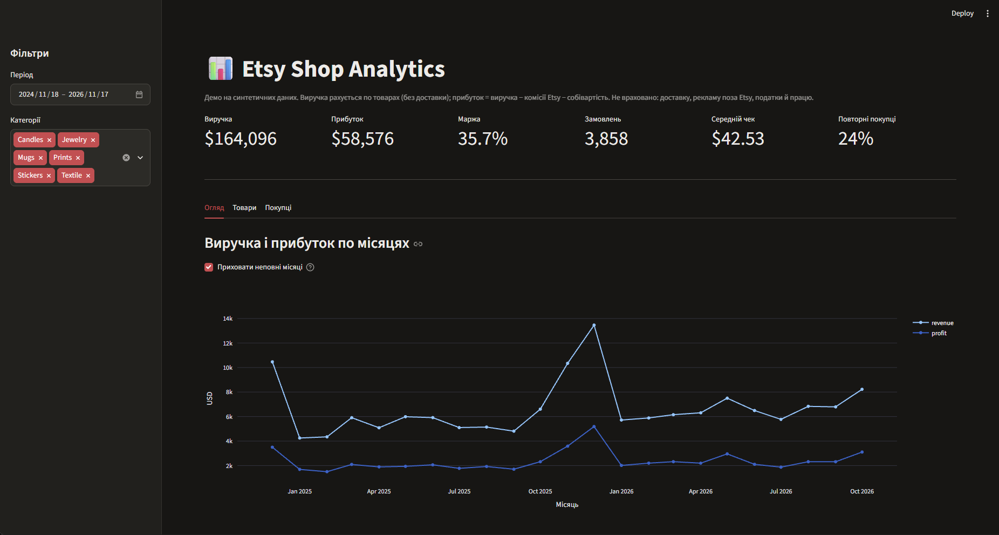
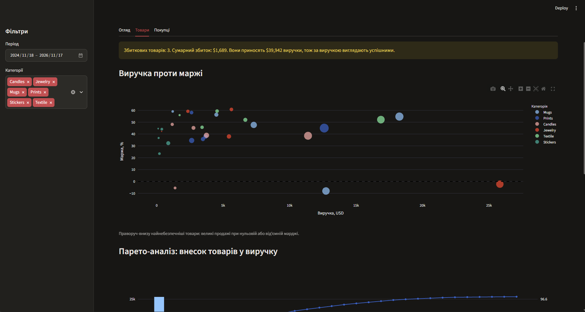
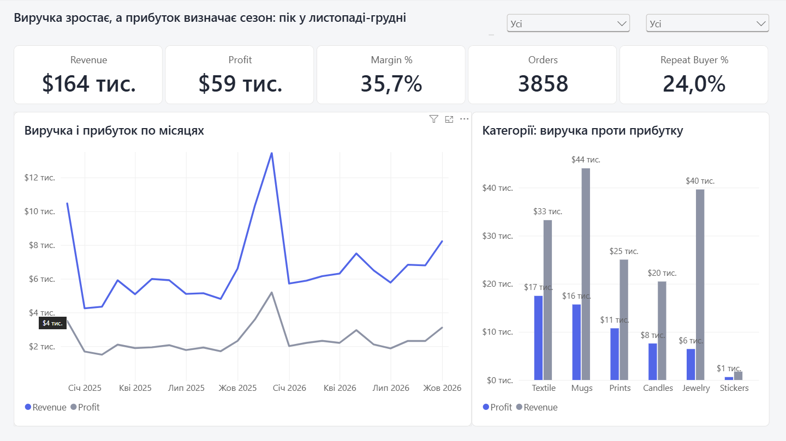
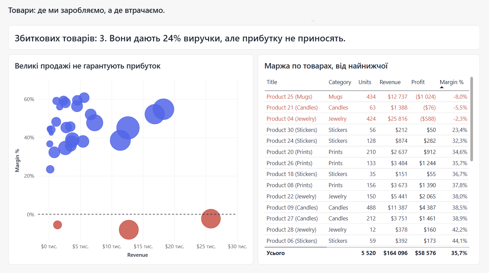
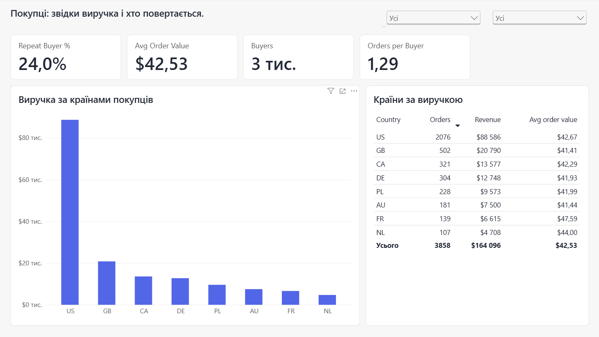

# Etsy Shop Analytics

[English version](README.md)

Наскрізний аналітичний проект навколо невеликого Etsy-магазину: дані в PostgreSQL, SQL-моделі, дашборд у Streamlit і звіт у Power BI поверх тих самих даних.

> **Важливо:** усі цифри в цьому репозиторії взяті із синтетичних даних. Справжні дані магазину на GitHub не потрапляють (докладніше нижче).

## Навіщо я це зробив

У моїх знайомих є магазин ручної роботи на Etsy. Etsy Stats показує, скільки вони продали, але не показує, скільки реально заробили, коли відняти комісії та матеріали. Я хотів відповісти на одне просте питання: **які товари справді варто виготовляти?**

Також мені хотілося проекту з реальним бізнес-питанням, а не ще одного застарілого датасету.

## Що всередині

- **Генератор даних**, який створює реалістичний вигаданий магазин: 30 товарів, 6 категорій, близько 3 900 замовлень за два роки, із сезонністю, зростанням і кількома товарами, що непомітно працюють у збиток.
- **PostgreSQL** (Docker) з невеликою схемою: товари, замовлення, позиції замовлень, собівартість, комісії Etsy.
- **SQL views**, що рахують прибуток по кожній позиції замовлення. Обидва дашборди читають один і той самий view, тому цифри завжди збігаються.
- **Дашборд у Streamlit** з фільтрами, Парето-аналізом і графіком «виручка проти маржі».
- **Звіт у Power BI** (3 сторінки) з тією самою історією, розказаною трохи інакше.
- **Тести якості даних** (pytest) і workflow у GitHub Actions, що запускає їх після кожного push.

## Архітектура

```
синтетичний генератор / Etsy API (заплановано)
        |
   CSV-файли (data/sample)
        |
   PostgreSQL: core.*  (таблиці)
        |
   PostgreSQL: analytics.v_item_facts  (один рядок на позицію замовлення, з комісіями, собівартістю й прибутком)
        |
   Дашборд Streamlit          Звіт Power BI
```

## Що кажуть дані

Ці закономірності я сам заклав у генератор, щоб перевірити, що аналіз їх знаходить. Вони показують, які відповіді має давати проект на реальних даних:

- **Три товари збиткові**, проте приносять близько 24% усієї виручки. Якщо дивитися лише на продажі, вони здаються успішними.
- Найбільший із них, ювелірний виріб, це **товар №1 за виручкою (~$26k) із від'ємним прибутком**.
- **Jewelry** друга категорія за виручкою, але лише п'ята за прибутком. Textile заробляє більше за меншої виручки.
- **Пік продажів припадає на листопад і грудень** (типова для Etsy сезонність святкових подарунків), а магазин зростає рік до року.
- **Покупці зі США дають понад половину виручки**, а близько **24% покупців повертаються** за другим замовленням.

## Дашборди

### Streamlit

| Огляд | Товари |
|---|---|
|  |  |

Ще скріншоти: [огляд, частина 2](docs/streamlit_overview_2.png), [товари, частина 2](docs/streamlit_products_2.png), [покупці](docs/streamlit_customers.png).

### Power BI

Файл звіту лежить у `dashboard/powerbi/etsy_demo.pbix` (лише синтетичні дані).

| Огляд | Товари | Покупці |
|---|---|---|
|  |  |  |

## Як рахується прибуток

```
прибуток = виручка - комісії Etsy - собівартість
```

- Etsy нараховує комісії на рівні замовлення (за розміщення, за транзакцію, за обробку платежу, за рекламу поза Etsy). Я ділю комісії замовлення між його позиціями пропорційно до їхньої виручки.
- Собівартість береться з окремої таблиці, бо Etsy не знає, скільки коштують матеріали. У справжньому магазині її заповнює власник магазину.
- **Не враховано:** доставку, рекламу поза Etsy, податки й працю. Тому маржа не ідеальна, але близька до реальності.
- Ставки комісій у генераторі приблизні. Перед тим як довіряти абсолютним цифрам, перевір актуальні комісії Etsy.

## Якість даних

`tests/test_data_quality.py` виконує 10 перевірок: унікальність ключів, відсутність порожніх значень у ключових колонках, коректні зовнішні ключі, додатні суми, «сума замовлення = товари + доставка», відомі типи комісій, реалістична частка повторних покупців тощо. Генератор також навмисно закладає три збиткові товари, і тест перевіряє, що вони нікуди не зникли.

```bash
pytest -q
```

## Запусти сам

Потрібні Python 3.12+ і Docker.

```bash
git clone https://github.com/SerhiiKuzub/etsy-analytics.git
cd etsy-analytics

cp .env.example .env        # потім задай пароль у .env
python -m venv .venv
source .venv/bin/activate
pip install -r requirements.txt

docker compose up -d
python -m src.synthetic.generate
python -m src.load.load_to_postgres

set -a; source .env; set +a
for f in sql/models/*.sql; do
  docker exec -i etsy_db psql -U "$POSTGRES_USER" -d "$POSTGRES_DB" < "$f"
done

streamlit run dashboard/app.py
```

Якщо порт 5432 на твоєму комп'ютері зайнятий, постав у `.env` значення `POSTGRES_PORT=5433` (так було в мене).

## Конфіденційність

Мета була така: публічний репозиторій із реальною історією та без жодних даних магазину:

- `.env`, токени та все в `data/raw` ігноруються git.
- Усі публічні дані згенеровані. Єдиний датасет у репозиторії це `data/sample`.
- Покупці зберігаються як хеші, ніколи як імена чи адреси.
- Pre-commit хук (gitleaks) перевіряє кожен коміт на секрети (щоб випадково не закомітити паролі, ключі API чи іншу непублічну інформацію).
- Файл Power BI в репозиторії зібраний лише на синтетичних даних.

## Що пішло не так (і чого я навчився)

Це мій перший серйозний проект такого масштабу (до того ж пов'язаний з реальним комерційним бізнесом, власники якого хотіли залишитися анонімними), тому помилок було чимало. Нижче те, на чому я навчився найбільше.

**Середовище та інструменти**

- Python був настільки свіжим, що для частини бібліотек (наприклад, PyYAML) не було готових збірок, і pip просив компілятор C++. Тепер я перевіряю сумісність версій і фіксую версію Python у проекті.
- Windows **Smart App Control** блокував скомпільовані бібліотеки Python (NumPy, SQLAlchemy), тому я переніс весь проект у WSL2. Попутно я наново навчився працювати в Linux-терміналі: права доступу, групи користувачів, шляхи між Windows та WSL.
- Локальний PostgreSQL у Windows уже займав порт 5432, тому Power BI постійно підключався не до тієї бази. Перенесення Docker-бази на інший порт це виправило.

**Секрети та безпека**

- Редактор залишив резервну копію мого файлу `.env` (`.env.save`), і вона мало не потрапила в коміт. Я помітив її в `git status` і доповнив `.gitignore`.

**Дані та аналітика**

- Перша версія генератора давала 59% повторних покупців, що нереально для Etsy. Тепер такі речі ловить автоматичний тест.
- Перший і останній місяці даних були неповними й створювали фальшиві «провали» на графіку. Я додав у view позначку повноти місяця.

**Чого я навчився**

Для мене це перший такий проект від початку до кінця. На практиці я підтягнув:

- **SQL:** CTE, віконні функції, агрегації, views, зв'язки між таблицями;
- **Python:** pandas, NumPy, SQLAlchemy, python-dotenv, Plotly, Streamlit, pytest;
- **Інструменти:** Docker, Git, GitHub Actions, WSL2, pre-commit;
- **Power BI:** модель даних, DAX-міри, умовне форматування, дизайн звіту;
- **Підхід:** єдине джерело правди для обох дашбордів, тести якості даних і чесні припущення в README.

## Плани

- [x] Синтетичні дані, SQL-моделі, дашборди Streamlit і Power BI, тести, CI
- [ ] Підтягнути реальні дані через Etsy API (доступ до API схвалено, далі екстрактори)
- [ ] Інкрементальне завантаження та щоденне оновлення за розкладом
- [ ] Прогноз продажів на найближчі місяці
- [ ] Публічне демо застосунку Streamlit

## Технології

Python, pandas, SQLAlchemy, PostgreSQL, Docker, SQL (CTE, віконні функції), Streamlit, Plotly, Power BI (DAX), pytest, GitHub Actions.

## Автор

Serhii Kuzub · [LinkedIn](https://www.linkedin.com/in/serhii-kuzub/) · [Telegram](https://t.me/serhiikuzub)